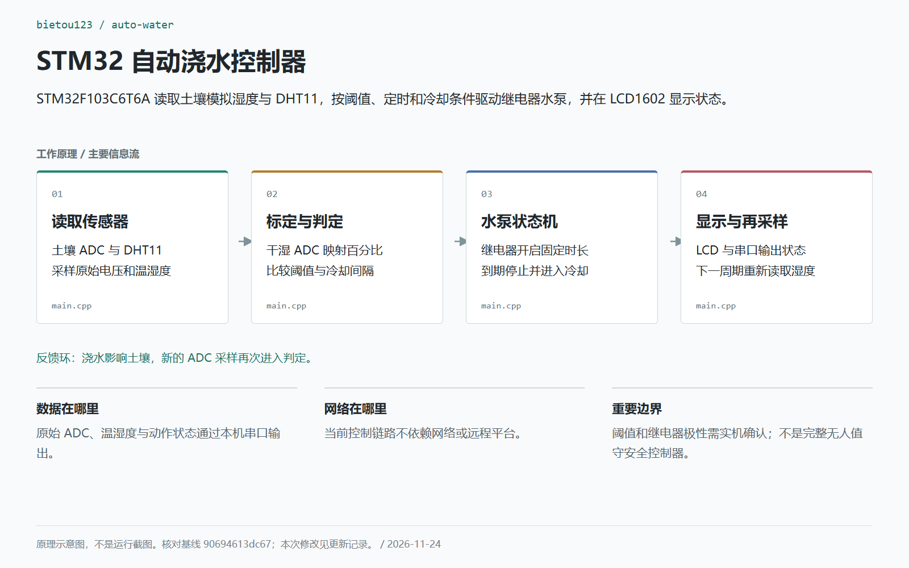
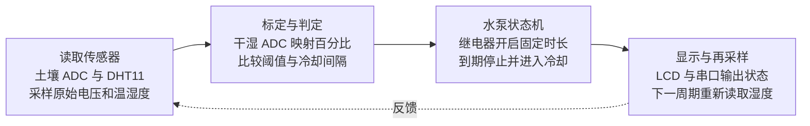

# STM32 自动浇水控制器

STM32F103C6T6A 读取土壤模拟湿度与 DHT11，按阈值、定时和冷却条件驱动继电器水泵，并在 LCD1602 显示状态。

**适合谁：** 学习 ADC、单总线时序、PWM、并口 LCD 与简单反馈控制的嵌入式爱好者。

## 一图看懂

上图是依据公开源码绘制的原理示意，不是运行截图；以下表格与文字提供相同信息，便于小屏阅读。

## 主链路与源码

| 步骤 | 做了什么 | 代码或说明入口 |
| --- | --- | --- |
| 1. 读取传感器 | 土壤 ADC 与 DHT11；采样原始电压和温湿度 | [src/main.cpp](../src/main.cpp) |
| 2. 标定与判定 | 干湿 ADC 映射百分比；比较阈值与冷却间隔 | [src/main.cpp](../src/main.cpp) |
| 3. 水泵状态机 | 继电器开启固定时长；到期停止并进入冷却 | [src/main.cpp](../src/main.cpp) |
| 4. 显示与再采样 | LCD 与串口输出状态；下一周期重新读取湿度 | [src/main.cpp](../src/main.cpp) |

## 关键原理

### 百分比来自设备标定

ADC 原始值按干、湿两端标定映射到百分比，阈值比较使用这个结果。不同探头、供电、土壤会改变端点；代码里的默认数值不能当作所有植物共用的真实含水量。

对应入口：[src/main.cpp](../src/main.cpp)。

### 时间条件限制水泵动作

固件检查是否正在浇水、湿度是否低于阈值，以及距上次动作是否超过冷却间隔。满足条件后开泵，到设定时长关泵；这是定时阈值控制，不是连续 PID 或流量闭环。

对应入口：[src/main.cpp](../src/main.cpp)。

### 细时序外设使用原生寄存器

DHT11 通过 GPIO 寄存器与 DWT 周期计数读取脉宽，减少通用 digitalRead 和微秒计时开销；LCD 使用自写 4 位并口驱动，PA3 的 TIM2 PWM 调对比度。

对应入口：[src/main.cpp](../src/main.cpp)。

## 数据与安全边界

| 范围 | 说明 |
| --- | --- |
| 数据 | 原始 ADC、温湿度与动作状态通过本机串口输出。 |
| 网络 | 当前控制链路不依赖网络或远程平台。 |
| 重要边界 | 阈值和继电器极性需实机确认；不是完整无人值守安全控制器。 |

## 运行与复现

安装 PlatformIO 后执行 pio run 仅编译。烧录前独立核对引脚、供电、继电器极性和干湿标定，勿带水泵做盲测。

本次为图文原理整理，没有执行设备动作、系统切换或付费请求。已有验收范围与运行条件以主 README 和相关报告为准。

## 已知限制

- DHT11 精度和响应较慢，土壤探头也有明显个体差异。
- 当前方案不是包含水位、流量、堵转和冗余切断的安全级控制系统。

## 本次更新

2026-11-24：新增项目专属原理图、源码入口、运行条件与边界说明。本项目本轮没有修改功能，也没有扩大既有实测结论。

## 可编辑流程图

下面的 Mermaid 与上方 PNG 表达同一主链路，便于后续维护：

[返回项目 README](../README.md)

源码核对基线：[90694613dc67](https://github.com/bietou123/auto-water/tree/90694613dc67146ead893848722d05acda961c92)，并结合本次更新中列明的改动。
